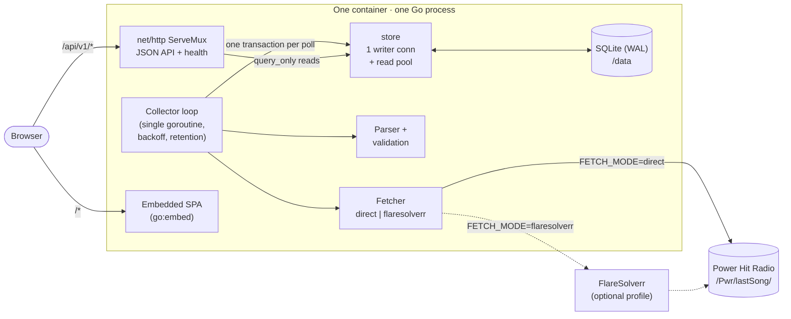
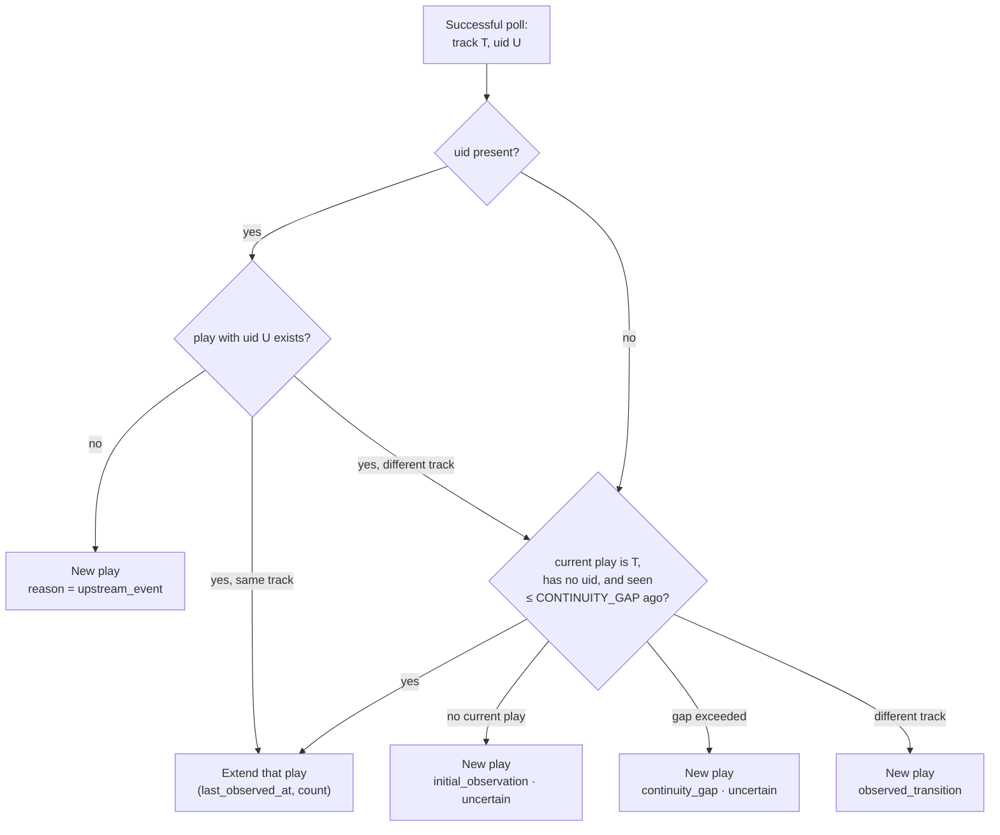

# Architecture

## Overview

| Package | Responsibility |
|---|---|
| `cmd/pwr-tracker` | Wiring, config, graceful shutdown, `healthcheck` / `backup` / `demo-seed` subcommands |
| `internal/upstream` | `Fetcher` interface (direct HTTP, FlareSolverr), typed errors, response parser |
| `internal/collector` | Polling loop with injected `Clock`, backoff, Retry-After, retention pruning |
| `internal/store` | SQLite connections, migrations, transactional write path, read queries |
| `internal/normalize` | Identity keys for artists and tracks |
| `internal/analytics` | Range parsing, timezone/DST-aware bucketing, period comparison |
| `internal/api` | JSON API, health endpoints, SPA fallback |
| `web/` | Vite + React + TanStack Router/Query/Store frontend |
| `cmd/fakeupstream` | Deterministic upstream imitation for development and e2e tests |

## Data model

- **artists**, **tracks** — stable identities. Keys are NFC-normalized,
  whitespace-collapsed and Unicode case-folded; nothing else is stripped.
  Display values are stored as first observed.
- **observations** — one row per successful poll (time, track, play, upstream
  uid/date, optional raw body). Pruned after `OBSERVATION_RETENTION`.
- **plays** — distinct airplay events. Never pruned.
- **collector_state** — single row: current play, first/last success, last
  attempt, last error, consecutive failures.

### Play identity

1. **Upstream event** (normal case, verified): the upstream `uid` identifies the
   play. Repeated polls, retries and restarts extend the existing play
   (unique index on `plays.upstream_uid`). A new `uid` is a new play even for
   the same track, so back-to-back repeats are counted.
2. **Inference** (fallback when no `uid` is present, or a `uid` contradicts a
   known track): consecutive observations of the same track within
   `CONTINUITY_GAP` belong to one play. Any change of track starts a new play
   (A → B → A = 3 plays; an intervening segment also breaks continuity).
   Consecutive repeats of the same track cannot be detected in this mode.

Each play records `reason` (`upstream_event`, `observed_transition`,
`initial_observation`, `continuity_gap`), `start_authoritative`, and
`uncertain`. `uncertain` is set for `initial_observation` and `continuity_gap`
plays (inference mode only): the play may continue one counted before the
gap/restart, and its true start is unknown.

`start_at` is the upstream start when provided, else `first_observed_at`. With
60-second polling, an inferred start can be up to one interval late, and the
true duration is unknown — `last_observed_at` is only the last time it was seen.

### Rankings and uncertainty

All airplay metrics count **plays** of **music** tracks whose `start_at` is in
`[from, to)`; observations are never counted. Uncertain plays are included in
counts (they represent at least one real airplay in nearly all cases) and are
reported separately (`uncertain_plays`) so the UI can show them. Collection
gaps longer than `CONTINUITY_GAP` are listed by the summary endpoint;
airplay inside gaps is missing, not estimated.

## Timezones

Everything is stored in UTC (fixed-width RFC 3339 text, so string order is
time order). Calendar concepts — days, hours, weekdays, default ranges — are
computed in Go in `ANALYTICS_TIMEZONE` (default `Europe/Vilnius`) using the
IANA database (embedded in the binary via `time/tzdata`). Daily buckets on DST
days are 23 or 25 hours long; hourly buckets around the autumn fall-back show
the repeated hour twice, with different offsets.

## Concurrency and SQLite

One process owns the database. Writes use a dedicated `*sql.DB` with one
connection and `BEGIN IMMEDIATE`, so the collector never contends with itself;
each poll's observation + play update + state change is one transaction.
API reads use a separate pool of four `query_only` connections, which WAL mode
lets run concurrently with the writer. `busy_timeout` is 5 s (relevant only
for external tools such as the `backup` subcommand). Polls run in a single
goroutine and therefore never overlap.

## Why SQLite fits

The workload is tiny and append-mostly: one write per minute (~525k
observations and ~150k plays a year), and read queries over indexed time
ranges. SQLite in WAL mode handles this with sub-millisecond writes, zero
operational overhead, trivially consistent backups (`VACUUM INTO`), and a
single-file volume — ideal for one container. A pure-Go driver
(`modernc.org/sqlite`) keeps the binary static and cross-compilable.

It is **not** designed for multiple replicas or for a database file on a
network filesystem (NFS/SMB), where SQLite locking is unreliable.

## When Parquet / DuckDB would help

They are deliberately not runtime dependencies. They become useful for
**offline analysis** at a scale or flexibility the API does not target:
multi-year cross-station comparisons, ad-hoc notebooks, or sharing datasets.
A natural extension is an export command that writes `plays` joined with
tracks/artists to Parquet (partitioned by month), which DuckDB can then query
directly. The SQLite file can also be read by DuckDB's `sqlite` extension
without any export.

## Implementation plan (as executed)

1. Inspect the upstream; record the contract and capture fixtures.
2. Vertical slice: upstream → collector → SQLite → API → now-playing/activity UI.
3. Analytics endpoints, track/artist detail pages, charts.
4. FlareSolverr transport (mock-tested, then verified against a real instance).
5. Docker, Compose, CI, release and security workflows, documentation.
