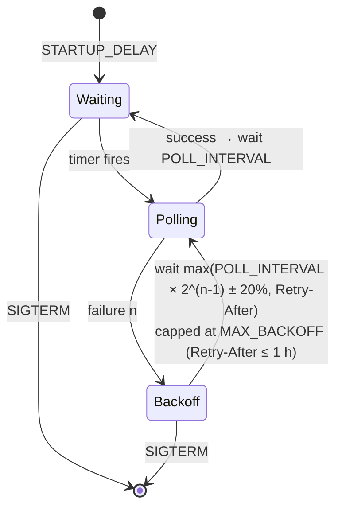

# Operations

## Deployment

```sh
docker compose up -d --build        # or use the published image
```

- One container, one process. The database lives in the `pwr-data` named
  volume at `/data/pwr-tracker.db` and survives container recreation.
- Use a **local** Docker volume or a bind mount on a local filesystem. Do not
  place the database on NFS/SMB or share it between replicas; SQLite locking
  is not reliable there, and the design assumes a single owner.
- The container runs as uid 65532. For a bind mount, make the directory
  writable for that uid: `mkdir data && sudo chown 65532:65532 data`.
- `docker stop` sends SIGTERM: the HTTP server drains, the collector stops
  (an in-flight poll is cancelled without recording a failure), the WAL is
  checkpointed, and the process exits — normally in well under a second.
- Health: the image's `HEALTHCHECK` runs `pwr-tracker healthcheck` against
  `/healthz`. Use `/readyz` for load-balancer readiness. Neither depends on the
  upstream, so an upstream outage never hides historical data.
- Put a TLS-terminating reverse proxy in front for public deployments.

### Published images

Release tags `vX.Y.Z` publish multi-arch (`linux/amd64`, `linux/arm64`)
images to both registries:

- `ghcr.io/aurimasniekis/pwr-tracker`
- `docker.io/aurimasniekis/pwr-tracker`

Tags: `X.Y.Z`, `X.Y`, `sha-<commit>`, and `latest` for stable releases only.
Docker Hub publishing needs the repository secrets `DOCKERHUB_USERNAME` and
`DOCKERHUB_TOKEN` (a Docker Hub access token with read/write scope); set the
repository variable `DOCKERHUB_REPOSITORY` to publish under a different
namespace. GHCR uses the workflow's `GITHUB_TOKEN`.

Standalone binaries (UI embedded) with `checksums.txt` are attached to each
GitHub Release.

## Responsible polling

The upstream is a public but undocumented endpoint of a commercial station.

- The default interval is 60 seconds — the station's own website polls it
  every 20 seconds per open browser tab, so one tracker adds negligible load.
  Do not lower it in production.
- Requests carry an identifiable User-Agent with a link to this project.


- Failures back off exponentially (×2 per failure, ±20 % jitter, capped at
  `MAX_BACKOFF`, 15 min by default) and honor `Retry-After` up to one hour.
  There is no immediate retry loop.
- Respect the station's terms of use and any access restrictions. If the
  endpoint becomes protected, using FlareSolverr to get around that may not
  be permitted. Check first, and stop polling if asked.
- FlareSolverr is optional and off by default (`FETCH_MODE=direct`). It may
  not solve every challenge. When enabled, every request goes through it;
  there is no automatic fallback.

### Enabling FlareSolverr

```sh
cat >> .env <<'ENV'
FETCH_MODE=flaresolverr
FLARESOLVERR_URL=http://flaresolverr:8191
ENV
docker compose --profile flaresolverr up -d
```

FlareSolverr's port is not published; never expose it to the internet.

## Retention

- `OBSERVATION_RETENTION` (default 90 days) deletes old observation rows
  hourly. Plays, tracks and artists are kept forever, so analytics history is
  unaffected; only gap detection before the retention horizon is lost.
- `STORE_RAW_PAYLOADS=false` by default. When enabled, raw bodies are cleared
  after `RAW_PAYLOAD_RETENTION` (default 7 days) while the observation row
  remains.

## Backup and restore

SQLite in WAL mode keeps recent writes in `pwr-tracker.db-wal`. **Copying only
the `.db` file of a running instance can produce a stale or corrupt backup.**
Use one of these instead.

### Online backup (recommended)

`pwr-tracker backup` uses `VACUUM INTO`, which writes a consistent,
self-contained snapshot (WAL contents included) while the app keeps running:

```sh
docker compose exec app pwr-tracker backup /data/backup-$(date +%F).db
docker compose cp app:/data/backup-$(date +%F).db ./
docker compose exec app pwr-tracker version   # record the version alongside
```

The `sqlite3` CLI equivalent is `sqlite3 pwr-tracker.db ".backup 'out.db'"`.

### Offline backup

Stop the app first (`docker compose stop app`). On a clean shutdown the WAL is
checkpointed. Then copy the `.db` file **together with any `-wal` and `-shm`
files**, and start the app again.

### Restore

```sh
docker compose stop app
docker run --rm -v pwr-tracker_pwr-data:/data -v "$PWD":/backup alpine \
  sh -c 'rm -f /data/pwr-tracker.db-wal /data/pwr-tracker.db-shm &&
         cp /backup/backup.db /data/pwr-tracker.db &&
         chown 65532:65532 /data/pwr-tracker.db'
docker compose start app
```

Always remove the old `-wal`/`-shm` files when restoring a `.db` file, or
SQLite may apply a stale WAL to the restored database. Migrations run on
startup; a backup from an older version is upgraded automatically, while a
database from a *newer* version is refused.
